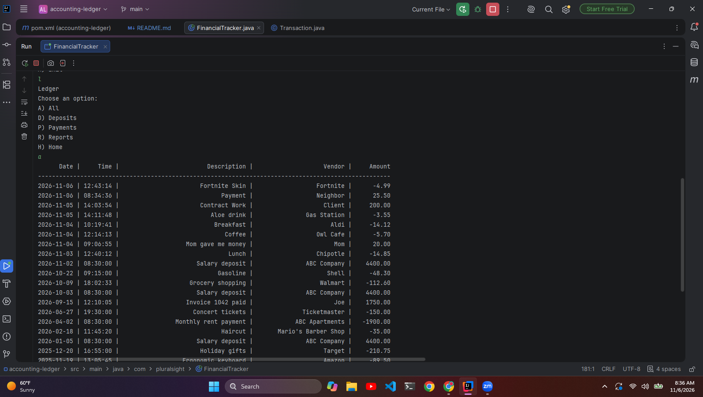
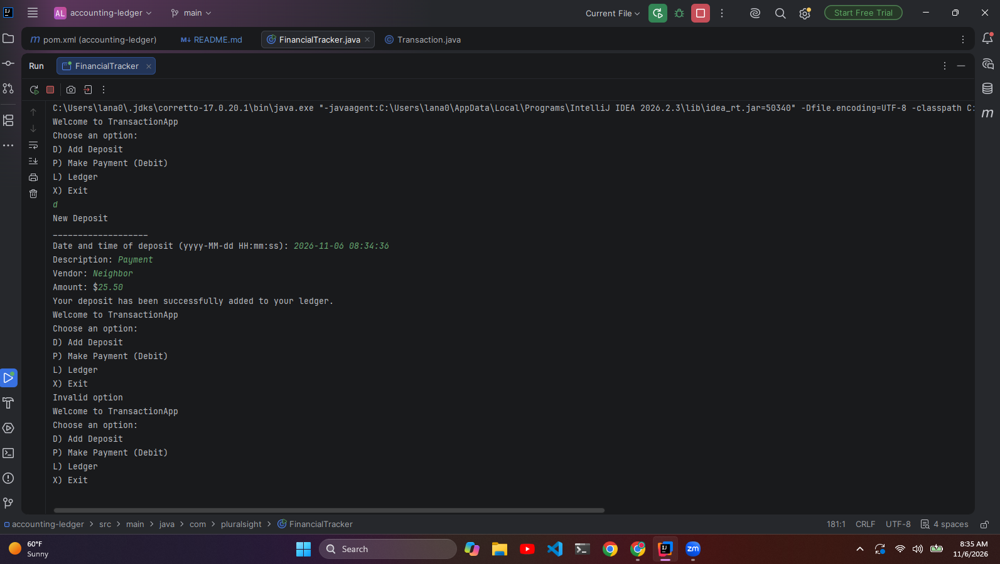

# Accounting Ledger

A console app that keeps a user's transactions in a csv file and lets the user add to or browse it with filters.

## Description of the Project

The purpose of this project is to track all financial transactions for a
business or for personal use. The user has the option to record and display both payments and deposits. The user 
may also generate reports for transactions this month or year (to-date) as well as transactions for the previous 
month or year.

## Features

- Displays home menu
- Adds deposits to ledger 
- Adds payments to ledger
- Displays ledger menu
- Exits application when prompted by user from home screen
- Displays all ledger entries
- Displays all deposits in ledger
- Displays all payments in ledger
- Displays reports menu
- Displays month-to-date report
- Displays previous month report
- Displays year-to-date report
- Displays previous year report
- Searches transactions by vendor
- Returns to ledger menu from reports menu when prompted
- Returns to home menu from ledger menu when prompted

## User Stories

- As a user, I want to be able to add deposits to my account so that I can keep my financial records updated and accurate.
- As a user, I want to be able to use the program to make payments so that I can manage and track my finances in one app.
- As a user, I want to be able to view all of my transactions in one place so that I can verify that everything is recorded correctly.
- As a user, I want to be able to filter my search so that I may see specific types of transactions.
- As a user, I want to be able to see my payments so that I can review them.
- As a user, I want to be able to see all of my transactions so far this month so that I can make decisions based on recent transactions.
- As a user, I want to be able to see all of my transactions from the previous month so that I can ensure that my recurring transactions are consistent.
- As a user, I want to be able to see all of my transactions so far this year so that I can make annual budget decisions based on the year's transactions.
- As a user, I want to be able to see all of my transactions from the previous year so that I can ensure that my recurring transactions are consistent.

## Setup

- If you have transactions to be loaded into the ledger upon running the program, put them in a file named transactions.csv in the project's root 
folder. The ledger will be populated with these items upon launching the application.
- A "matching" vendor name is not case sensitive, but must include the whole

### Prerequisites

- Java 17 (Amazon Corretto), the version used in class.
- IntelliJ IDEA Community Edition: <https://www.jetbrains.com/idea/download/>

### Running the application

1. Clone this repository, or download it as a zip and unzip it.
2. In IntelliJ: File > Open, pick the project folder (the one that holds `pom.xml`), press Open.
3. Wait for IntelliJ to finish indexing (progress bar at the bottom).
4. Open `src/main/java/com/pluralsight/FinancialTracker.java`.
5. Right-click inside the file and choose Run 'YourMainClassName.main()'.

### Data and configuration

-`transactions.csv` sits at the project root, next to `pom.xml`. The program reads it at start and appends new transactions 
as needed. The program will create this file if it does not already exist.

## Technologies Used

- Java 17
- IntelliJ IDEA
- Maven build system

## Demo

<!-- Pictures of the app running: the console for a console app, Insomnia or Swagger for an API.
     Screenshots are enough; a GIF is a bonus.
     1. Create a folder named `images` at the project root, next to `pom.xml`.
     2. Take screenshots of the app in the IntelliJ console (the menu, one feature, one error message):
          Windows: Win + Shift + S, drag a rectangle, then paste into Paint and save as PNG, or open the
                   notification and save. Save into the `images` folder.
          Mac:     Shift + Cmd + 4, drag a rectangle. The file lands on the Desktop; move it into `images`.
     3. Name the files by what they show: `images/menu.png`, `images/search.png`.
     4. Reference each one below with a relative path. No spaces in file names.
     5. Commit the images with the rest of your work (Git > Commit shows them as unversioned files: tick them).
     Optional GIF: LICEcap (free, Windows and Mac, <https://www.cockos.com/licecap/>) records a region of the
     screen straight to a .gif. Keep it under 10 seconds and under 10 MB, save it into `images`. -->





## A piece of code I am proud of

```java
private static void printTransaction(Transaction transaction) {
        System.out.printf("%9tF | %8tT | %35s | %25s | %10.2f%n",
                transaction.getDate(),
                transaction.getTime(),
                transaction.getDescription(),
                transaction.getVendor(),
                transaction.getAmount()
        );
    }
```
I am proud of this code because it's neat, readable, and very useful. Instead of being DRY and typing this 
statement out every time I needed it, I put it into a method. I was able to save a lot of time and space by formatting 
my code this way.

## Future Work

<!-- What you would add or fix next, one bullet each. Unfinished bonuses belong here. -->

- Input bug - I would fix the input bug that causes the program to cycle through the home screen unprovoked after inputting 
a new transaction.
- I would complete the bonus custom search feature.
- I would

## Resources

- Java YearUp Fall 2026 hub: <https://raymaroun.github.io/yearup-java-fall2026/>
- Official Java Documentation by Oracle: <https://docs.oracle.com/javase/tutorial/index.html>
- W3Schools Java Tutorials: <https://www.w3schools.com/java/>
- Instructor Raymond's YearUp GitHub <https://github.com/RayMaroun/yearup-fall-section-8-2026>

## Author

- **Alana Kendrick**

## Thanks

- Thank you to Autumn, Jennifer, and Brendan for discussions, problem-solving sessions, and tips.
- Thank you to Raymond for academic guidance, the visual hub, starter code, and the explanations.